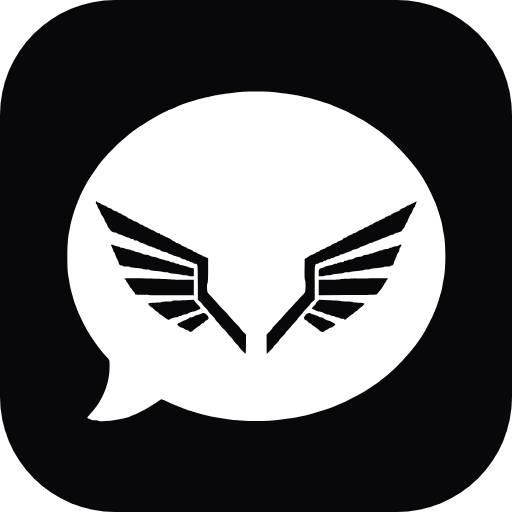

  

<h1 align="center">Angelgram</h1>

<b>Black, white, and a touch of red. The power of Telegram, in your own style.</b>

  

---

**Angelgram** is an Android messaging app built on the Telegram infrastructure. You log in using your existing Telegram account; all your chats, groups, channels, and files come along with you.

## Why Angelgram?

- **Dark and minimalist.** The default theme features black and white with red accents. It’s easy on the eyes and comfortable to use at night.
- **A unique identity.** Wings inside a speech bubble—it has its own logo, its own name, and its own custom launch animation.
- **Fast startup.** Go straight to your chats after a brief, one-second launch animation. No introductory tours.
- **A familiar interface.** Everything you’re used to in Telegram is right where it should be. There’s nothing new to learn. ## Everything you get with Telegram

- Unlimited chats, groups, and channels
- Large files, photos, and videos
- Voice and video calls
- Secret chats
- Stickers, emojis, and reactions
- Stories
- Multiple accounts
- Synchronized messaging across all your devices

## Screenshots

<!-- Add in-app images to the preview/screenshots/ folder and uncomment the line below:

    

-->

*Coming soon.*

## Branding

  

## Technical notes

Angelgram is a client built upon the official open-source [Telegram Android](https://github.com/DrKLO/Telegram) client, utilizing the Telegram API with its own API keys. It is neither affiliated with nor endorsed by Telegram.

Telegram Android is licensed under the GPLv2; this project is subject to the same license.
